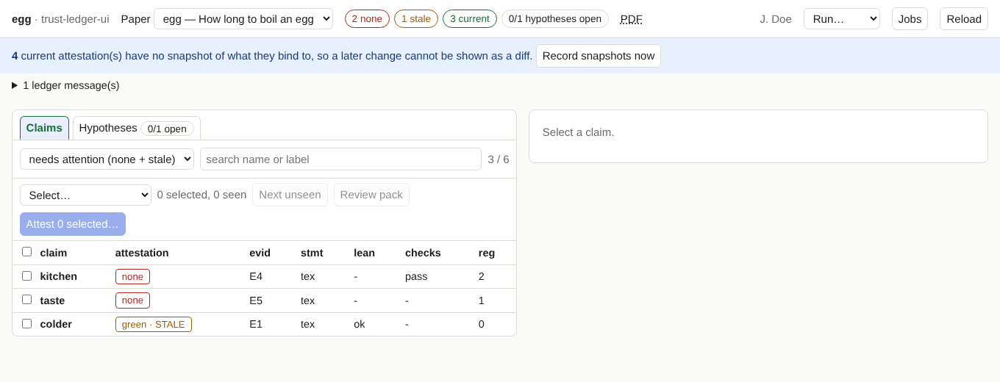

# trust-ledger-ui

A local web page for the [trust-ledger](../trust-ledger) of a paper project: browse the claims and hypotheses of several
papers, see which are missing an attestation or have a stale one, read the statements (mathematics rendered with KaTeX) next
to their back-translations and Lean text, see **what changed** since you signed, and attest one claim or many at once, with
one reason, signed through your **ssh-agent**.



**User manual:** [docs/](docs/index.md), built with mkdocs (`uv run mkdocs serve`). Start with *Before you start*
([docs/requirements.md](docs/requirements.md)) and *Install and first start* ([docs/install.md](docs/install.md)).

## Quick start

```bash
git clone <url of trust-ledger> ; git clone git@github.com:HansAschauer/trust-ledger-ui.git   # next to each other
cd trust-ledger-ui && uv sync
uv run ledger-ui --init path/to/your/project/ledger/ledger.toml           # once: writes ./ledger-ui.toml
uv run ledger-ui                                                          # prints an address; opens the browser
```

For attesting you also need a key that is registered in the ledger (`ledger.py addkey`) and loaded in your ssh-agent
(`ssh-add`); see [docs/signing.md](docs/signing.md).

## What it is, and is not

- Python standard library only on the server, no framework, no build step. Alpine.js and KaTeX are included
  (`src/trust_ledger_ui/static/VENDOR.md`).
- Listens on `127.0.0.1` only, with a token; signs only through ssh-agent; one signature per attestation.
- Keeps no state of its own about the ledger: it reads and writes the ledger's own files
  ([what is written](docs/security.md)).
- Version 0.0.1. It needs the library API of trust-ledger after 2026-11-06 (`status --json`, `claim_detail`, `diff_since`).

## Development

Specification and design decisions: [docs/development/](docs/development/specification.md). Tests, the browser test and
regenerating the screenshots: [docs/development/testing.md](docs/development/testing.md).

Licence: MIT.
