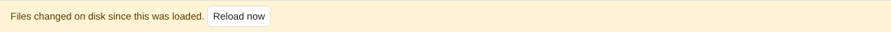
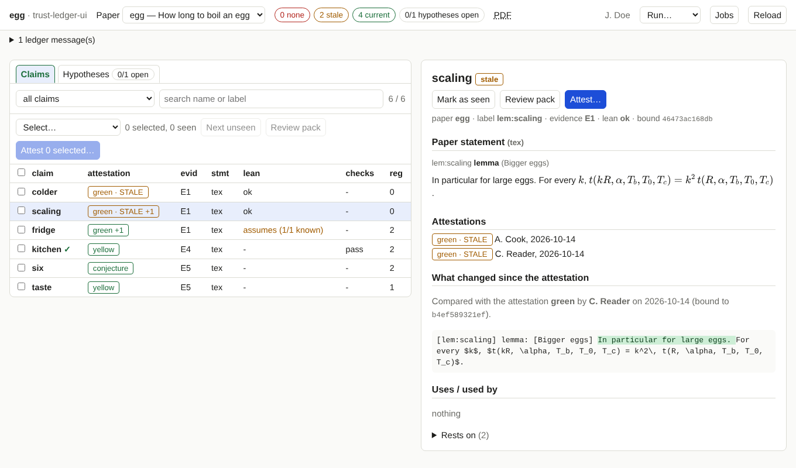

# After you edited the paper

!!! info "Prerequisites"
    A project whose ledger the tool can read ([install](install.md)). For re-attesting also a loaded key
    ([signing](signing.md)); for the Lean step, whatever your project's `extract` needs; for packs, LaTeX.

Whenever the paper's statements, the Lean code or the evidence behind a claim change, the claims that rest on it become
**stale**. This page is the routine for that situation. Pick the steps that apply.

```
edit → (Lean changed?  run extract) → Reload → read what changed → [review pack] → attest again → lock → rebuild the paper
```

## 1. Let the ledger see the change

- **You edited the LaTeX of a paper:** nothing to do. The page notices on its own.
- **You changed the Lean code:** the ledger reads Lean through an extracted dump. Run **Run… → extract Lean evidence**
  ([jobs](jobs.md)). It runs your project's extractor (for Lean, Docker; it takes minutes, so it asks first).

## 2. Reload

The amber bar appears within about five seconds of a change on disk:



Press **Reload now**. The ledger is read again (a few seconds). The counts change: claims that depend on what you edited are
now *stale*.

## 3. Read what changed

Select a stale claim. Under **What changed since the attestation** you see the difference between what was attested and what
is there now:



Removed text is red, new text green. Under it, changed evidence (for example the type or value of a Lean declaration it
depends on). The first sentence says *which* attestation it is compared with. How this works, and why it is sometimes
unavailable, is on [Snapshots and diffs](snapshots.md).

## 4. Decide

- The change is harmless (a typo, a comment): attest again, with a reason such as "wording only".
- The change matters: read the claim again, and the claims that use it. Build a [review pack](review-packs.md) for the stale
  claims to read them side by side with their formal statements.

## 5. Attest again

Select the claims, mark them seen, attest: [Attest claims](attesting.md). A new attestation is bound to the new state. Older
attestations stay in the history and are shown as stale.

## After attesting

Attestations and evidence enter the root hash that the paper prints. To make the paper agree with the ledger:

1. **Run… → write the lock file** (`lock`), then **verify** to check it ([jobs](jobs.md)).
2. On the command line, regenerate the files the paper includes, then rebuild the paper:

   ```bash
   python3 path/to/ledger.py -P NAME tex
   ```

   (`ledger.py status` prints a note when the root in the paper's generated file is older than the ledger's.)

!!! note "Why the second step is not a button"
    The `tex` command writes into your paper's source tree. The tool leaves that to you for now.
