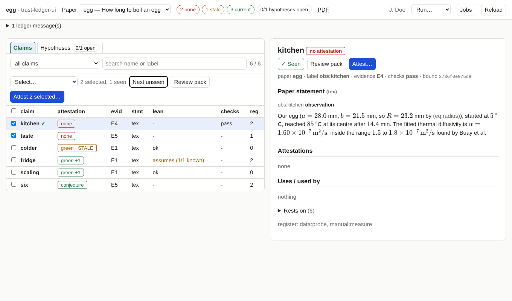
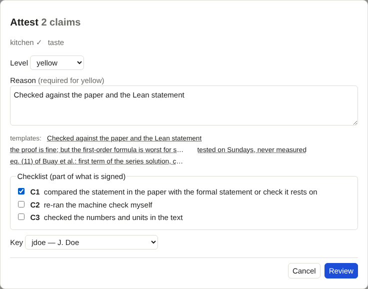
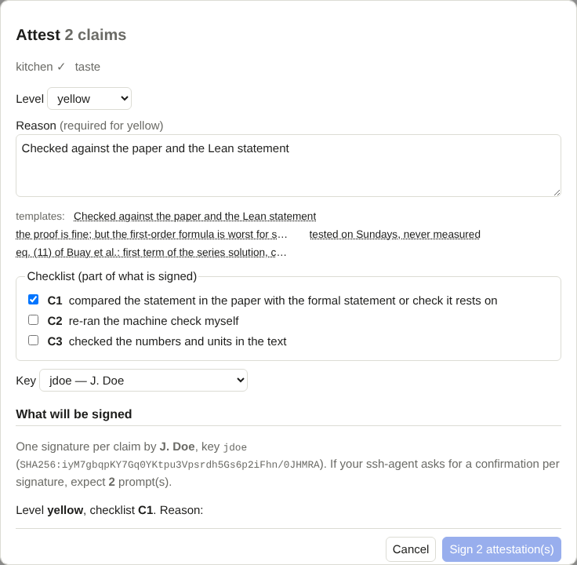
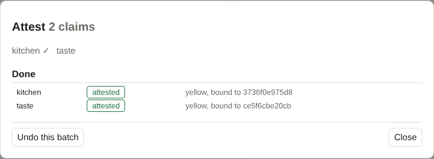

# Attest claims

!!! info "Prerequisites"
    - The tool runs and shows your paper ([install](install.md)).
    - Your key is registered in the ledger and loaded in your ssh-agent ([signing](signing.md)).
    - You have read the claims you are about to attest. The tool helps you remember which ones you read; it cannot read
      for you.

An attestation says: *this person has examined this statement, in this state, at this level of confidence, for this reason.*
Each one is bound to the exact state of the statement and of the evidence behind it. If either changes, the attestation
becomes **stale** and the claim shows up again under *needs attention*.

## Levels

The ledger knows three levels, **green**, **yellow** and **conjecture**. What each means for your paper is for your project to
agree on (the ledger itself only demands that a **yellow** attestation has a **reason**). A common reading:

| Level | Typical use | Reason |
|---|---|---|
| **green** | you have checked it and vouch for it | optional |
| **yellow** | you vouch for it with a reservation or after a lighter check | **required** |
| **conjecture** | you record it as a conjecture, not as established | optional |

Your project may define a **checklist** (items such as "re-ran the machine check myself"). Ticked items are part of what is
signed.

## One claim

1. Click the claim in the list. Read the statement, the back-translation and the Lean statement, if there are any.
2. Press **Mark as seen** (<kbd>v</kbd>). The claim gets a `✓` in the list.
3. Press **Attest…** (<kbd>a</kbd>).
4. Choose level, enter a reason, tick checklist items, check the key.
5. **Review**, then **Sign**.

## Many claims with one reason

1. Narrow the list: the filter (*needs attention*, *no attestation*, *stale* …) and the search box.
2. Use **Select…**: *all shown*, *all stale*, *all without attestation*, *shown, not yet seen*, or *clear selection*. You can
   also tick rows, press <kbd>x</kbd>, or use the checkbox in the table header for everything shown.
3. Read them. **Next unseen** opens the next selected claim you have not marked; press <kbd>v</kbd> when you have read it.
   The bar shows *N selected, M seen*.
4. Press **Attest N selected…**.

!!! tip "The loop that works"
    Filter to *stale*, **Select… → all stale**, build a [review pack](review-packs.md) for the selection, read it, mark the
    claims *seen*, attest.

## The dialog

- **Level** and **Reason**. Templates under the reason field fill it in: the ones from your config and your most recent
  reasons. One reason applies to the whole batch.
- **Checklist.** The items that apply to claims.
- **Key.** The registered keys, with a note if one is not in your agent
  ([see](signing.md)).

## Review: what will be signed

Pressing **Review** asks the server to check everything and show a summary. Nothing is signed yet.

- the person, the key and its fingerprint, and how many signatures (and agent prompts) to expect;
- the **exact reason text** that will be signed;
- a table of the claims: what each has now, the **bound** hash (the state being attested), and whether you marked it as seen;
- problems per claim (a wrong checklist item, for example). Claims with a problem are left out.

**Claims you did not mark as seen** are listed in an amber box. You can still sign them, but only after ticking *I am
attesting claims I have not marked as seen*. It is a warning, not a block; the decision is yours. If you change anything in
the dialog, the review is discarded and you review again.

## Sign

**Sign N attestation(s)** starts the job. For each claim in turn, the server

1. checks that the statement and its evidence are still exactly what the review showed, and **skips the claim** if not;
2. asks your ssh-agent for a signature (confirm there if your agent asks) and verifies it;
3. appends the record to `ledger/attestations.toml` and records a [snapshot](snapshots.md).

A failure on one claim does not stop the others; the result table says what happened to each (*attested*, *skipped*,
*failed*). Attested claims leave the selection.

## Undo

Right after a batch, **Undo this batch** removes exactly the records it appended from `attestations.toml`, provided nothing
else has changed that file since. After that, or after you close the dialog and do something else to the file, remove
records by hand.

## What stays in your hands

- *Seen* is **your** mark: it is kept in this browser, per claim and state, and is not written to the ledger. It does not
  prove you read anything; it helps you remember.
- Each signature is made by your key, through your agent, on your say-so.
- Every action is logged to `ledger-ui.log` next to the config file.

Next: after you sign, update the lock file ([jobs](jobs.md)) and rebuild the paper, as in
[After you edited the paper](after-edit.md#after-attesting).
