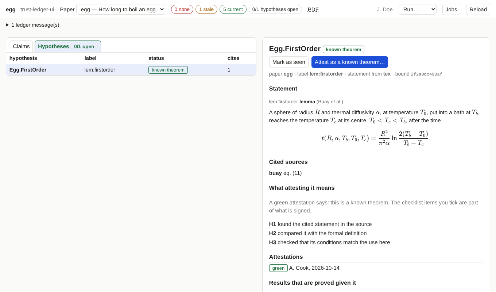

# Attest a hypothesis

!!! info "Prerequisites"
    As for [attesting claims](attesting.md): a registered key, loaded in your ssh-agent.

Some results are proved *given* a hypothesis, typically a known theorem from the literature that is not formalised in the
project. The ledger lists it as a **hypothesis** and records who has checked that it really is that known theorem.

## Steps

1. Open the **Hypotheses** tab (or press <kbd>t</kbd>). The list shows each hypothesis with its status: *known theorem*,
   *stale* or *not attested*.
2. Click one. You see its statement (from the paper if the paper states it, otherwise the hand-written text), the **cited
   sources** as links, what attesting it means, its attestations, and the results that are proved given it.
3. **Open the cited source and check it.** The checklist of your project says what to check, typically: found the cited
   statement in the source; compared it with the formal definition and with the paper's statement; checked that the
   conditions match (objects, field, symmetry, order).
4. **Mark as seen**, then **Attest as a known theorem…**. The dialog is the one from [attesting claims](attesting.md), with
   the checklist for hypotheses. A **green** attestation means: *this is a known theorem*.
5. Review, sign.

The list of *results that are proved given it* links to those claims.

!!! note "The same hypothesis can look different in different papers"
    A hypothesis has one statement per scope. If one paper states the lemma and another only cites it, the second one uses the
    hand-written text of the ledger entry, which has a different hash. An attestation made in the first paper then shows as
    *stale* when you look at the second. That is the ledger's rule: you attest the statement as it is used where you look.
