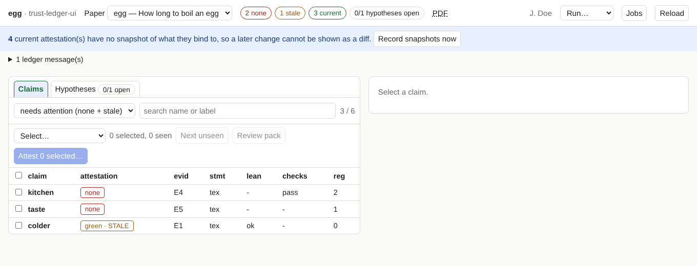

# trust-ledger-ui

**A local web page for the trust ledger of a paper project.**
Browse every claim of your papers, see which have no attestation or a stale one, read what would be signed, and attest
one claim or many at once, with the same reason, signed through your `ssh-agent`.

## What it does

| You want to … | Page |
|---|---|
| see which results of which paper still need an attestation | [A tour of the page](tour.md) |
| attest one claim, or a whole selection, with one reason | [Attest claims](attesting.md) |
| attest that a hypothesis is a known theorem | [Attest a hypothesis](hypotheses.md) |
| find out what changed since you signed | [Snapshots and diffs](snapshots.md) |
| read the paper statement next to the formal statement | [A tour of the page](tour.md), [Review packs](review-packs.md) |
| run `lock`, `verify`, `check`, `extract` without a terminal | [Background jobs](jobs.md) |

The page renders the mathematics (KaTeX), so reading before signing happens where you sign. Nothing is signed that you have
not seen in the preview, and every signature is made by your own key through your own `ssh-agent`.

## What you need

Short version: Python 3.11 with [uv](https://docs.astral.sh/uv/), a checkout of trust-ledger, a project that has a
`ledger/ledger.toml`, and, for attesting, an SSH key that is registered in the ledger and loaded in your agent.
The details, per task, are on [Before you start](requirements.md).

## Where to begin

1. [Before you start](requirements.md): what each task needs.
2. [Install and first start](install.md): five minutes.
3. [Setting up signing](signing.md): once per person.
4. [Attest claims](attesting.md): the everyday workflow.

!!! note "Written for"
    Authors of papers that use a trust ledger: you write the paper (and perhaps its Lean formalisation) and you are one of
    the people who vouch for its results. You do not need to know how the ledger works inside; the documentation of the
    trust-ledger repository explains the method.

!!! warning "Status"
    Version 0.0.1, written alongside trust-ledger 0.3.0 (ledger format 0.3.0). It needs a `ledger.py` that has the library
    API this tool uses (`status --json`, `claim_detail`, `diff_since` and so on); the manual says where that matters.
