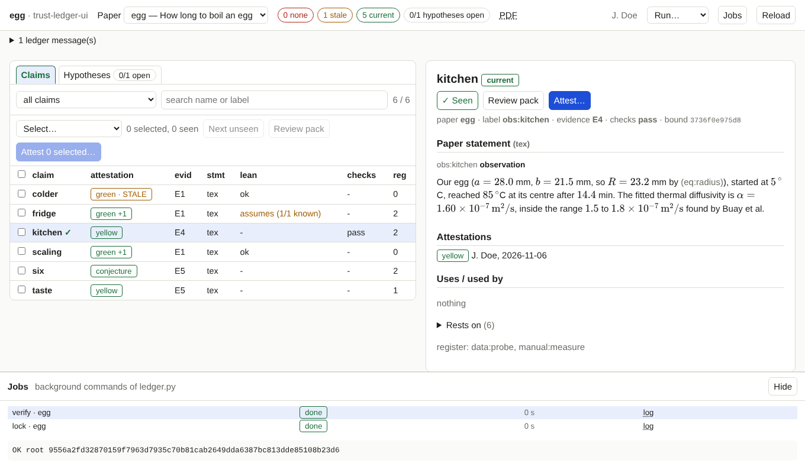

# Background jobs

!!! info "Prerequisites"
    Nothing beyond a working tool, except what the job itself needs: LaTeX for review packs, the project's extractor
    (for Lean: Docker) for `extract`.

Some `ledger.py` commands take a while. The tool runs them in the background, shows their output as it appears, and keeps
working while they run.

## Start one

The **Run…** menu in the header offers:

| Entry | Runs | Effect |
|---|---|---|
| verify the lock file | `ledger.py [-P paper] verify` | recomputes the root and compares it with the lock file |
| write the lock file | `ledger.py [-P paper] lock` | writes `lock.json` (or `lock-NAME.json` for a selected paper) |
| run the checks | `ledger.py check` | runs the project's `[check.*]` commands and records the results |
| extract Lean evidence (Docker) | `ledger.py extract` | runs the extractors of all adapters and writes their dumps; **asks first**, takes minutes |

*Review pack* is started from the claim list ([Review packs](review-packs.md)).

With a paper selected, `lock` and `verify` apply to that paper; with *all papers* they apply to the whole ledger.

## Watch and control

**Jobs** in the header opens the panel at the bottom. Each row shows what ran, its state (*running*, *done*, *failed*,
*cancelled*), how long it took, and links: **log** (the output, streamed while it runs), **open pack** (for review packs) and
**cancel** (for a running job).

## Rules

- **One job per kind at a time.** Starting a second `verify` while one runs is refused with a message.
- **Only one Lean job at all.** `extract` starts Docker Lean, which does not run twice in parallel.
- **`extract` is never started automatically**, and always asks.
- The tool starts only these commands, with arguments it builds from checked names. The page cannot send a command line.
- After `lock`, `check` or `extract` finish, the page reloads the ledger, because they changed files it reads.

A job that fails shows its exit status and its output; the output usually says why.
