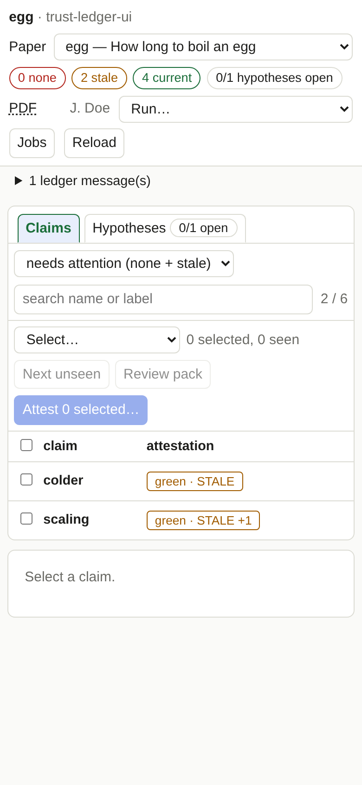
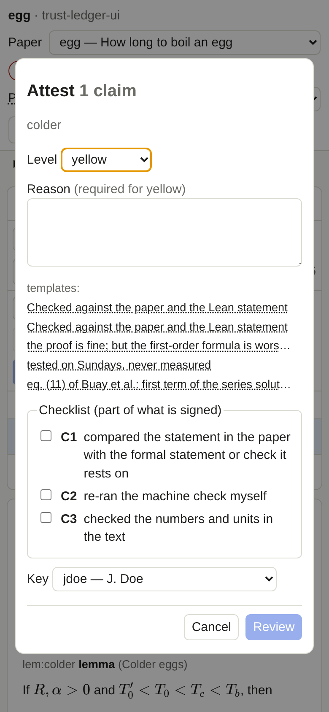

# From another device

!!! info "Prerequisites"
    SSH access from the other device to the machine where the tool runs, and a way to forward a port (the `-L` option of
    `ssh`, or the port-forwarding feature of your SSH app).

The tool **never listens on a network interface**: it binds to `127.0.0.1`, and it rejects requests whose `Host` is anything
but `127.0.0.1` or `localhost` with its own port. That is deliberate, because it can sign in your name. To use it from a
laptop or a phone, bring the port to the device through an SSH tunnel.

## Steps

1. On the machine with the project, give the server a fixed port in `ledger-ui.toml`:

   ```toml
   [server]
   port = 8765
   open_browser = false
   ```

2. Start it there: `uv run ledger-ui`. Note the address with the token.
3. On your device, open a tunnel **with the same port on both sides**:

   ```bash
   ssh -L 8765:127.0.0.1:8765 you@the-machine
   ```

4. In the browser of your device, open `http://127.0.0.1:8765/#TOKEN` (the token from step 2).

!!! warning "Signing happens where the tool runs"
    The ssh-agent that signs is the one in the environment the tool was started in, on that machine. Do not forward your
    agent to a machine you do not trust.

## On a phone

The page adapts to narrow screens: one column, a list with the claim and its attestation, the detail below it, and a dialog
that fits the screen.

<div style="display:flex; gap:1rem; flex-wrap:wrap" markdown>
{ width="260" }
{ width="260" }
</div>

Reading, selecting, marking as seen and attesting all work with touch. Keyboard shortcuts need a keyboard.
