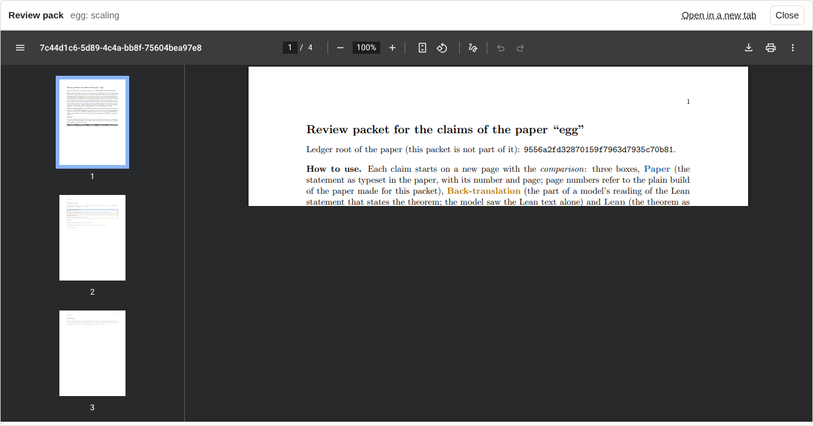

# Review packs

!!! info "Prerequisites"
    `latexmk` and `pdflatex`, and a paper that builds. One paper must be selected in the paper menu (a pack belongs to one
    paper). Back-translations of the formal statements appear in the pack if the ledger's `[review]` section names them.

A **review pack** is a PDF that puts what you are about to vouch for side by side: the claims' statements from the paper,
the back-translations of the formal (Lean) statements, and the Lean text, with the definitions they use gathered once. It
also covers what the claims rest on (the claims they use and the Lean steps). It is made by the ledger's own
`review` command; the tool runs it for you and shows the result.

## Build one

- For **one claim**: open it and press **Review pack**.
- For **several**: select them ([Attest claims](attesting.md#many-claims-with-one-reason)) and press **Review pack** in the
  bar above the table.

The pack is built as a [background job](jobs.md): the paper is built once for its numbers and references, then the pack
twice. A small paper needs ten seconds; a large one minutes. The job's log is in the **Jobs** panel, and the PDF opens under
the list when it is done. **Open in a new tab** gives you the browser's own viewer at full size; **Close** hides it.

## When a pack is out of date

If a claim in the pack changes after the pack was built, the viewer shows an amber note *older than the statement of …*.
Build it again. It compares the claims you selected; a change to something they only rest on is not detected, so rebuild
after larger edits.

## Where the files go

`.ledger-ui/packs/<job id>/` next to your config file (the PDF and the LaTeX of the body). The project's own `review/`
directory is **not** touched, so a pack made here never overwrites one you made by hand. Add `.ledger-ui/` to your ignore
file.

## Typical loop

1. Filter to *stale*, select them all.
2. **Review pack**, read it.
3. Mark the claims *seen*, **Attest N selected…**.
