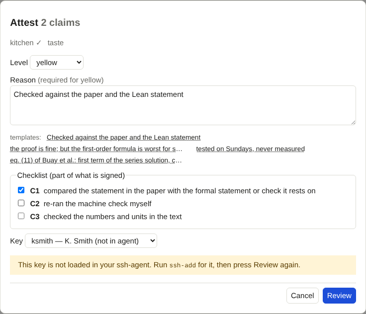

# Setting up signing

!!! info "Prerequisites"
    OpenSSH (`ssh-keygen`, `ssh-agent`, `ssh-add`) and a project whose ledger you may add a key to. Needed once per person,
    only if you want to **attest**; browsing needs none of it.

An attestation is a statement by a named person, signed with that person's SSH key. The tool signs through your
**ssh-agent**. It never asks for a passphrase and never reads a private key file; the agent holds the unlocked key and
makes the signature. That is why the setup below matters.

## 1. A key with a passphrase

If you have no key for this purpose yet:

```bash
ssh-keygen -t ed25519 -C "you@example.org" -f ~/.ssh/id_ed25519_ledger
```

Choose a passphrase. A key without one lets anyone who can read the file sign as you.

## 2. Register the key in the ledger

Once per person and project, from the project root:

```bash
python3 path/to/trust-ledger/ledger.py addkey yourid --person "Your Name" --pub ~/.ssh/id_ed25519_ledger.pub
```

`yourid` is a short name for the key; it appears in the tool's key menu and in `ledger/keys.toml`. The person's name is what
appears under every attestation. Commit `ledger/keys.toml` with the project; it holds public keys only.

## 3. Load the key into the agent

At the start of each session:

```bash
ssh-add ~/.ssh/id_ed25519_ledger
ssh-add -l          # the key is listed
```

To have the agent load keys on first use, put this in `~/.ssh/config`:

```
Host *
    AddKeysToAgent yes
```

!!! tip "No agent running?"
    Most desktop environments start one. In a plain terminal: `eval "$(ssh-agent -s)"`, then `ssh-add`. The tool reads
    `SSH_AUTH_SOCK` from the environment it was started in, so start `ledger-ui` from the same session.

## 4. Tell the tool which key to use

In `ledger-ui.toml`:

```toml
[signing]
key = "yourid"
```

The dialog lets you choose another registered key; the config only sets the default. The person is taken from
`ledger/keys.toml`, not from the config.

## What you will see

When you open the attest dialog, each key shows whether the agent holds it:



If the selected key is **not in agent**, the dialog tells you to run `ssh-add`; nothing can be signed until the agent has
it. Press **Review** again afterwards.

## One signature per attestation

Every attestation is signed by its own `ssh-keygen` call. If you use an agent that asks for confirmation on every use
(`ssh-add -c`), expect one prompt per claim, and the review step tells you how many. That is intended: a signature should be
deliberate, and the tool never bundles or caches one.
