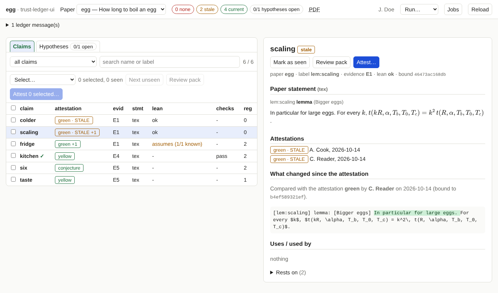

# Snapshots and diffs

!!! info "Prerequisites"
    None for reading a diff. To *have* diffs for attestations you made before this feature existed, record snapshots once
    (below).

When a claim becomes stale, the ledger can say *that* it changed, because an attestation stores only a hash of what it bound
to. To say *what* changed, the tool needs the text from the time of the attestation. That is a **snapshot**.

## What a snapshot is

A small file `ledger/snapshots/<bound-hash>.json`, written whenever the tool (or `ledger.py attest`) records an attestation.
It holds the statement text, the evidence behind the claim with its content (for a Lean declaration: its type and value, and
the declarations it depends on), and the statements of the claims it uses.

- It is **not** part of the ledger's hashes or its root; deleting it changes nothing about what is attested.
- It is named by the hash, so one file serves all attestations of the same state.
- Commit `ledger/snapshots/` with the project, so that your co-authors can see the same diffs.

## The diff

For every claim or hypothesis with a stale attestation, the detail view shows **What changed since the attestation**,
compared with the latest attestation that has a snapshot:

| Part | Shows |
|---|---|
| statement | a word-level difference of the LaTeX source (red removed, green added) |
| *uses* | claims it uses whose statement changed, with their difference |
| evidence nodes | each changed Lean declaration, file or citation, field by field. If only a *dependency* of a declaration changed, it says so |

The line above the difference names the attestation it is compared with (person, date, level).

## Attestations without a snapshot

Attestations made before snapshots existed have none. The page shows a blue bar:

> *N current attestation(s) have no snapshot of what they bind to, so a later change cannot be shown as a diff.*
> **Record snapshots now**

Pressing it writes a snapshot for every attestation that is **current right now**. On the command line:
`ledger.py snapshot`. Do it while the attestations are current: that is the last moment the text they bound to is still
available.

!!! warning "Stale already, no snapshot"
    If an attestation is stale *and* has no snapshot, the text it bound to is gone, and the page says so ("no snapshot was
    recorded … it cannot be compared"). You see that something changed, not what. Your version control, if the project uses
    one, may still hold the old text.

Standalone attestation files (`ledger.py attest … --out`) and `attest --no-snapshot` write no snapshot.
