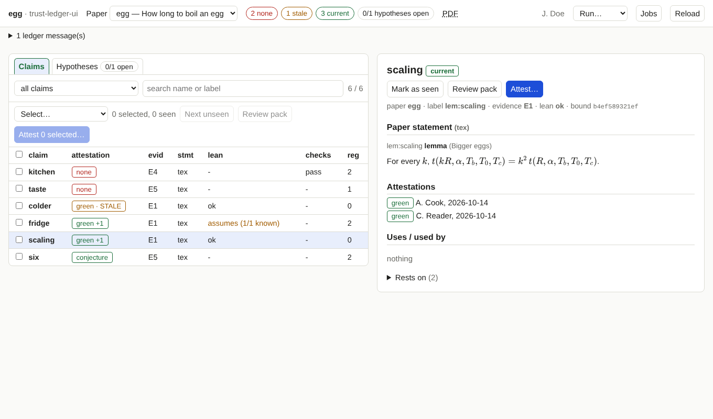

# A tour of the page

!!! info "Prerequisites"
    The tool is running ([install](install.md)). Nothing else; this page is only about looking.

## The regions

**Header.** The project, the **paper** menu (with the paper's title if it has a `paper.toml`), counts for the paper, links to
its PDFs, the person, the **Run…** menu for [background jobs](jobs.md), **Jobs**, and **Reload**.

The counts:

| Chip | Meaning |
|---|---|
| **none** | claims without any attestation |
| **stale** | claims that have attestations, but none is current: the statement or what it rests on changed since |
| **current** | claims with at least one current attestation |
| **hypotheses open** | hypotheses nobody has attested as a known theorem (yet) |

**Claim list** (left). Tabs *Claims* and *Hypotheses*. For claims: a filter (the default is *needs attention*: none plus
stale), a search over names and labels, and columns for the attestation, the evidence class, where the statement comes from
(`tex` or `manual`), the state of each tool (for example Lean) and the size of the register. Click a column header to sort.
On a narrow screen only the claim and its attestation are shown.

**Detail** (right). The paper statement, the back-translation of the formal statement and the Lean statement if the project
has them, the attestation history, what the claim uses and what uses it (click to jump), what it rests on, and, if it is
stale, [what changed](snapshots.md).

## Reading what is shown

- **Attestation column.** The strongest *current* attestation, for instance `green +1` (one more by someone else) or
  `green · STALE` (only stale ones).
- **`✓` after a name** marks claims you have marked as *seen* in this browser.
- **Rendering.** Formulas are drawn with KaTeX. A formula the renderer cannot draw is shown as source in red, with the
  reason as a tooltip, and the detail view lists how many there were. Unknown LaTeX commands in the text appear in amber.
  Nothing is hidden silently.

## Banners and messages

| Banner | What it tells you |
|---|---|
| *Files changed on disk since this was loaded* (amber) | an input of the ledger changed; **Reload now** reads it again |
| *N current attestation(s) have no snapshot* (blue) | see [Snapshots and diffs](snapshots.md) |
| *N ledger message(s)* | warnings and errors that `ledger.py status` prints, for example labelled results that are not in the ledger |

## Keyboard

Shortcuts work when no text field has the focus. Every action also has a button.

| Key | Action |
|---|---|
| <kbd>j</kbd> / <kbd>k</kbd> | next / previous claim (or hypothesis) |
| <kbd>x</kbd> | add the current claim to the selection or remove it |
| <kbd>v</kbd> | mark the current claim as seen / not seen |
| <kbd>a</kbd> | attest the selection, or the current claim if nothing is selected |
| <kbd>t</kbd> | switch between claims and hypotheses |

## Links you can bookmark

`?paper=NAME&claim=NAME` opens a paper and a claim directly. The address is kept up to date while you click, so reloading the
page returns to where you were.

## What is *not* shown

The tool shows the ledger as it is on disk. It keeps no database of its own; closing the tab loses nothing except the
*seen* marks, which live in the browser.
